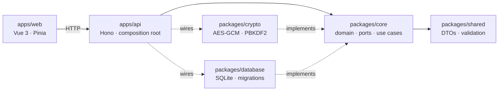

<div align="center">

# SecretVault

**A local-first secrets and environment-variable manager, encrypted at rest.**

[](https://github.com/cesar-martinez-fullstack/secrets-env-project/actions/workflows/ci.yml)
[](LICENSE)
[](https://github.com/cesar-martinez-fullstack/secrets-env-project/releases)
[](https://www.conventionalcommits.org)

English · [Español](README.es.md)

</div>

SecretVault keeps your API keys, tokens and `.env` variables in an encrypted SQLite
file on **your own machine**. No cloud, no accounts, no telemetry, no outgoing network
requests. One master password unlocks the vault; the encryption key lives **only in RAM**
while the vault is unlocked and is wiped when it locks.

> **Golden rule:** secrets never touch disk in plaintext, and the encryption key never
> touches disk at all.

## Features

- **Encrypted vault** — AES-256-GCM, key derived from a master password with PBKDF2-HMAC-SHA256 (600k iterations by default).
- **Environments** — organise secrets into `Local`, `QA`, `Production`… with per-environment counts.
- **Masked by default** — values are never listed; they only leave the server through an audited `reveal`.
- **Global search** — instant, case-insensitive search by variable name across all environments.
- **Import / export** — paste a `.env` to import; export as `.env`, CSV or a printable PDF.
- **Audit log** — every unlock, failed unlock, reveal, export and password rotation is recorded (never with values).
- **Auto-lock** — locks after inactivity, with an absolute session lifetime cap.
- **Password rotation** — re-encrypts every secret atomically under a new key.
- **Secret generator**, light/dark theme, and a single-container Docker deployment.

## Security model

SecretVault is built for **one user on one machine**. It is intentionally not reachable from your network.

| Layer          | Control                                                                                                       |
| -------------- | ------------------------------------------------------------------------------------------------------------- |
| Network        | Binds to `127.0.0.1`; Docker publishes the port on loopback only                                              |
| Browser        | Host allow-list (anti DNS-rebinding), Origin check (anti CSRF), strict CSP, `X-Frame-Options: DENY`           |
| Authentication | Opaque 256-bit session token in an `HttpOnly`, `SameSite=Lax` cookie; sliding + absolute expiry               |
| Brute force    | Rate limiting on unlock / setup / change-password (protects the master password, not an "API")                |
| Cryptography   | AES-256-GCM, random IV per operation, **AAD bound to the row** (a ciphertext cannot be moved between secrets) |
| Storage        | Parameterised SQL, versioned migrations, `CHECK` constraints, atomic transactions, `secure_delete`            |
| Supply chain   | Minimal runtime dependencies (the API only depends on `hono`), pinned lockfile, non-root container            |

Honest limitations — please read [docs/SECURITY.md](docs/SECURITY.md):

- The master password is **unrecoverable by design**. Lose it and the secrets are gone.
- Variable **names** are stored in plaintext (needed for instant search); values and notes are encrypted.
- JavaScript cannot guarantee secure erasure of RAM; keys are zeroed on a best-effort basis.
- This project has **not** been independently audited. Use it at your own risk.

To report a vulnerability, see [SECURITY.md](SECURITY.md).

## Quick start

### Docker (recommended)

```bash
git clone https://github.com/cesar-martinez-fullstack/secrets-env-project.git
cd secrets-env-project
docker compose up -d --build
# open http://localhost:3000
```

Data lives in the `secretvault-data` Docker volume. Back it up like any other sensitive file.
`docker compose down` keeps your data; `docker compose down -v` **deletes the vault**.

### From source (Bun)

Requires [Bun](https://bun.sh) ≥ 1.4.

```bash
bun install
bun run dev            # API on :3000 + Vite on :5173 → open http://localhost:5173
```

Production-style run:

```bash
bun run build          # builds the SPA and a single self-contained binary in ./dist
./dist/secretvault     # serves API + UI on http://localhost:3000
```

## Configuration

Set variables in your shell, in `docker-compose.yml`, or in a `.env` file (see [.env.example](.env.example)).
Precedence: real environment > `.env` > defaults.

| Variable               | Default     | Description                                                  |
| ---------------------- | ----------- | ------------------------------------------------------------ |
| `PORT`                 | `3000`      | HTTP port (API and UI share one origin)                      |
| `HOST`                 | `127.0.0.1` | Listen interface. **Do not expose to your network.**         |
| `SV_DATA_DIR`          | `./data`    | Folder holding `secrets.db`                                  |
| `SV_PUBLIC_DIR`        | `./public`  | Folder with the compiled SPA                                 |
| `SV_AUTO_LOCK_MINUTES` | `15`        | Inactivity before the vault locks                            |
| `SV_SESSION_MAX_HOURS` | `12`        | Absolute session lifetime                                    |
| `SV_PBKDF2_ITERATIONS` | `600000`    | KDF iterations (100k–2M). Applied when the vault is created  |
| `SV_MAX_BODY_KB`       | `2048`      | Maximum request body size                                    |
| `SV_ALLOWED_HOSTS`     | —           | Extra `Host` values to accept (loopback is always allowed)   |
| `SV_COOKIE_SECURE`     | `false`     | Set `true` only if you serve it over HTTPS                   |
| `SV_TRUST_PROXY`       | `false`     | Trust `X-Forwarded-For` (only behind your own reverse proxy) |

## Architecture

A modular monolith in a Bun monorepo, following Clean Architecture (ports & adapters).
The dependency rule is **enforced by tests** (`tests/architecture.spec.ts`).



| Path                | Responsibility                                                           |
| ------------------- | ------------------------------------------------------------------------ |
| `packages/shared`   | Shared kernel: DTOs, constants, validation, `.env` parser                |
| `packages/core`     | Entities, ports and use cases — **zero framework dependencies**          |
| `packages/crypto`   | Implements the crypto port with `node:crypto`                            |
| `packages/database` | Implements persistence ports with `bun:sqlite`; migrations; unit of work |
| `apps/api`          | HTTP layer, security middleware, dependency injection                    |
| `apps/web`          | Single-page app; talks to the API over HTTP only                         |

## Development

```bash
bun test                    # full suite (Jest-compatible API on bun:test)
bun run typecheck           # strict TypeScript in every package
bun run lint:check          # ESLint (typed) — must report 0 errors
bun run test:architecture   # layer-boundary rules
bun run test:security       # OWASP-mapped and perimeter tests
bun audit                   # dependency vulnerabilities
```

Git hooks (Husky) run lint-staged, type checks and Conventional Commit validation automatically.

Docs: [architecture](docs/ARCHITECTURE.md) · [ADRs](docs/adr/README.md) · [context](docs/context.md) · [testing](docs/TESTING.md) · [security model](docs/SECURITY.md) · [git workflow](docs/GIT_WORKFLOW.md) · [roadmap](docs/TODO.md)

## Contributing

Contributions are welcome. Please read [CONTRIBUTING.md](CONTRIBUTING.md) first — it covers the
Git Flow branching model, Conventional Commits and the test expectations. By participating you
agree to the [Code of Conduct](CODE_OF_CONDUCT.md).

## Versioning

[Semantic Versioning](https://semver.org). Releases are annotated `vX.Y.Z` tags on `main`; the
history is in [CHANGELOG.md](CHANGELOG.md). Until `1.0.0`, minor versions may change the on-disk
format — read the changelog before upgrading and keep a backup of your vault.

## License

[MIT](LICENSE) © Cesar Martinez
