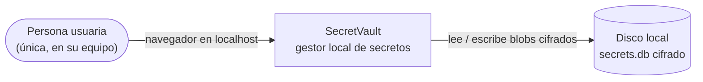
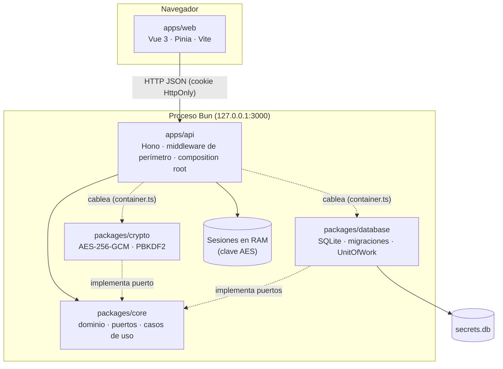

# Arquitectura de SecretVault

Visión de conjunto para quien llega al proyecto. Las decisiones puntuales y sus alternativas están en
los [ADRs](adr/README.md); las reglas ejecutables, en `tests/architecture.spec.ts`.

## 1. Contexto (C4 · nivel 1)

No hay sistemas externos: ni nube, ni cuentas, ni telemetría, ni peticiones salientes. Eso simplifica
el modelo de amenazas (no hay SSRF ni secretos de terceros que custodiar en tránsito).

## 2. Contenedores (C4 · nivel 2)

## 3. Atributos de calidad y cómo se logran

| Atributo                  | Objetivo                                   | Mecanismo                                                              |
| ------------------------- | ------------------------------------------ | ---------------------------------------------------------------------- |
| **Confidencialidad**      | Un atacante con el disco no ve secretos    | AES-256-GCM, clave solo en RAM, KDF con 600k iteraciones               |
| **Integridad**            | Detectar manipulación de datos             | Tag GCM + AAD ligado a la fila, `CHECK`/FK, `quick_check`, migraciones |
| **Consistencia**          | Nunca quedar a medias                      | `UnitOfWork` (atomicidad), `synchronous=FULL` (durabilidad)            |
| **Aislamiento de acceso** | Solo este equipo                           | Bind loopback, Host/Origin guards, CSP, puerto Docker en loopback      |
| **Mantenibilidad**        | Cambiar una pieza sin tocar las demás      | Puertos y adaptadores, reglas de dependencia verificadas por tests     |
| **Testabilidad**          | Probar la lógica sin infraestructura       | DI por constructor, reloj/azar inyectables, SQLite `:memory:`          |
| **Operabilidad**          | Fácil de arrancar y diagnosticar           | Un contenedor/binario, `/api/health`, auditoría local                  |
| **Recuperabilidad**       | Poder volver atrás tras un error o pérdida | Transacciones, migraciones versionadas; backup/restore (ver TODO)      |

## 4. Trade-offs asumidos (no hay balas de plata)

| Decisión                                      | Ganamos                                                                          | Pagamos                                                                                                   |
| --------------------------------------------- | -------------------------------------------------------------------------------- | --------------------------------------------------------------------------------------------------------- |
| **SQLite en un archivo**                      | Cero operación, ACID, backup = copiar un archivo                                 | Un solo escritor, sin replicación ni alta disponibilidad                                                  |
| **Monolito modular**                          | Simplicidad de despliegue y de depuración, fronteras claras                      | No escala por componentes (no hace falta para un usuario)                                                 |
| **Clave solo en RAM + clave de recuperación** | El disco nunca contiene la clave; se recupera el acceso sin servidores ni correo | La clave de recuperación es un segundo secreto a custodiar; sin ella ni la contraseña no hay recuperación |
| **Nombres de variables en claro**             | Búsqueda instantánea con SQL                                                     | Los nombres son metadata visible para quien lea el disco                                                  |
| **AAD ligado a la fila**                      | Un blob no se puede mover entre secretos                                         | Renombrar obliga a re-cifrar                                                                              |
| **Puertos `async` sobre SQLite síncrono**     | Cambiar de motor sin tocar `core`                                                | Pequeño coste de `Promise` que hoy no aporta rendimiento                                                  |
| **Solo loopback**                             | Superficie de ataque mínima                                                      | No sirve para uso en red/equipo sin un proxy propio y revisión de seguridad                               |
| **Sin dependencias en `shared`/`core`**       | Núcleo portable y fácil de auditar                                               | Validación escrita a mano (candidata a esquema, ver TODO)                                                 |

## 5. Qué NO hacemos (y por qué) — YAGNI explícito

| Patrón / tecnología                     | Decisión | Razón                                                                                 |
| --------------------------------------- | -------- | ------------------------------------------------------------------------------------- |
| Microservicios, serverless, API Gateway | No       | Un usuario, un proceso; añadirían red, despliegue y superficie de ataque              |
| CQRS / Event Sourcing                   | No       | Un modelo de lectura/escritura basta; el historial relevante ya está en la auditoría  |
| Colas / brokers (Kafka, RabbitMQ, SQS)  | No       | No hay trabajo asíncrono ni integraciones; las exportaciones son síncronas y pequeñas |
| Caché (Redis/CDN)                       | No       | Los datos caben en memoria/SQLite; cachear secretos descifrados sería un riesgo       |
| Sharding / replicación                  | No       | Volumen de datos de un usuario; se resuelve con backup                                |
| Circuit breaker / Saga                  | No       | No hay llamadas a servicios externos ni transacciones distribuidas                    |
| OAuth2 / OIDC / JWT                     | No       | Una sola persona con contraseña maestra; la sesión es un token opaco en RAM           |
| Kubernetes                              | No       | `docker compose` cubre el despliegue                                                  |

Cada "No" se reevalúa si cambia el contexto (ver sección 6).

## 6. Camino de evolución (si el alcance crece)

| Si aparece…              | Cambia…                                                                                                                                     | Sin tocar…                              |
| ------------------------ | ------------------------------------------------------------------------------------------------------------------------------------------- | --------------------------------------- |
| Varios usuarios / equipo | Motor a PostgreSQL (nuevo adaptador de `database`), autenticación por usuario, cifrado por usuario/clave de envoltura (envelope encryption) | `core` (casos de uso), contratos de DTO |
| Acceso remoto            | Reverse proxy con TLS (`SV_COOKIE_SECURE`, `SV_TRUST_PROXY`), revisión de amenazas, rate limit por usuario                                  | Cifrado en reposo                       |
| Observabilidad real      | Logs estructurados (JSON), `/api/ready`, métricas opcionales; OpenTelemetry solo si hay servicio desplegado                                 | Dominio                                 |
| Integraciones (CI, CLI)  | Nuevo adaptador de entrada (CLI) sobre los mismos casos de uso                                                                              | `core`, `crypto`, `database`            |
| Más formatos de export   | Registro de exportadores (Strategy)                                                                                                         | Rutas                                   |
| Cambio de KDF/cifrado    | Versión de formato en `vault_meta` + migración de datos (skill `db-migration`)                                                              | API pública                             |

## 7. Seguridad y resiliencia por diseño

- **Security by design**: perímetro, cifrado y auditoría están en el diseño, no añadidos después; cada control
  tiene un test que falla si se retira.
- **Resiliencia de datos** (equivalente a DRP a esta escala): transacciones, `quick_check` al abrir, migraciones
  transaccionales y rechazo de esquemas más nuevos. Falta un **comando de backup/restauración verificado**
  (copia consistente con `VACUUM INTO` + prueba de restauración); está priorizado en [TODO.md](TODO.md).
- **Fallos controlados**: ante error inesperado se falla cerrado (500 genérico, rollback), nunca a medias.
- **Observabilidad a escala local**: auditoría de eventos de seguridad (sin valores) y un `health` para el
  contenedor. Logs estructurados y `ready` están en el TODO; métricas distribuidas/tracing no aplican.

## 8. Documentar decisiones

- Decisiones difíciles de revertir → un **ADR** en `docs/adr/` (plantilla en su README).
- Cambios de estructura → actualizar los diagramas de este documento en el mismo cambio.
